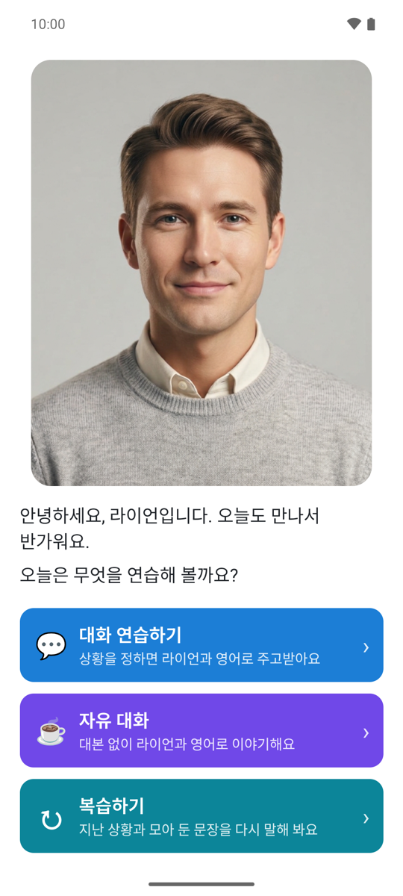
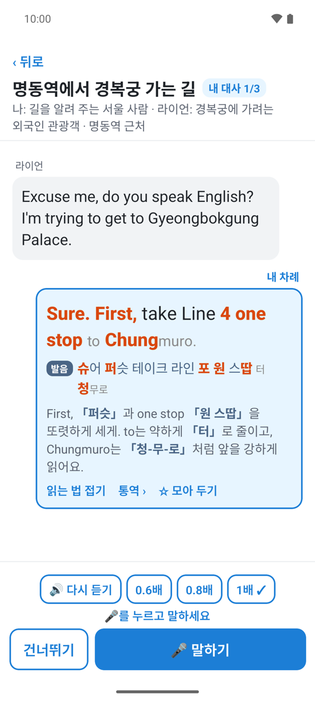
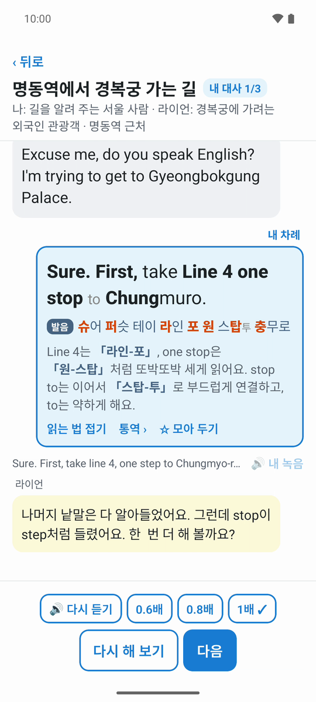
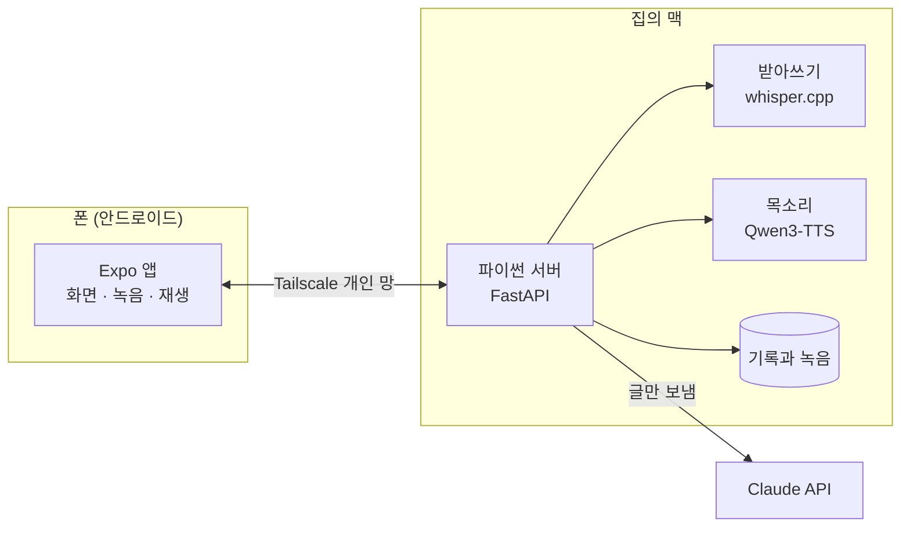

# jake-english

  

제가 쓰려고 만든 영어 말하기 연습 앱입니다. 폰에서 AI 선생님 라이언과 상황 대화를 주고받고, 제 녹음을 바로 평가받습니다. 계산은 집의 맥이 하고, 폰은 화면과 녹음만 맡습니다.

앱이 결과물이라면, 이 저장소는 그 과정입니다. 저는 무엇을 만들지와 여러 안 중 무엇을 고를지 정하고, 머지할지 판단했습니다. 기획 문서, 설계, 구현, 테스트, PR 리뷰는 AI 코딩 에이전트(Claude Code)가 했습니다. 그 규칙과 기록을 처음부터 함께 남겼습니다.

> **English summary.** jake-english is a speaking-practice app I built for myself. On an Android phone I role-play everyday situations with an AI teacher, Ryan, and get feedback on each recording right away. A Mac at home transcribes my speech, compares it with the script line, and explains in Korean which words sounded different and how to say them. Speech recognition (whisper.cpp) and the voices (Qwen3-TTS) run on the Mac, and only text goes to the Claude API, so recordings never leave the Mac. I decided what to build and whether to merge. An AI coding agent (Claude Code) wrote the specs, plans, code, tests and PR reviews under the rules in [AGENTS.md](AGENTS.md), and each feature has a devlog of what the AI proposed and what I decided. The documents are in Korean, and so is the 3-minute [introduction video](https://youtu.be/5FByJLa8R1k) (app demo from [1:42](https://youtu.be/5FByJLa8R1k?t=102)).

## 소개 영상

[Jake English 소개 (유튜브, 3분 17초)](https://youtu.be/5FByJLa8R1k)

앞부분에서 만든 이유와 동작 방식을 소개하고, [1:42부터](https://youtu.be/5FByJLa8R1k?t=102) 앱을 시연합니다.

## 무엇을 하는 앱인가

| 기능 | 하는 일 |
|---|---|
| 대화 연습하기 | 주제와 상황을 고르면(예: 길에서 외국인이 지하철역을 묻는 상황) 라이언과 제 대사가 담긴 대본이 나옵니다. 라이언이 영어로 말하면 저는 제 대사를 소리 내 말합니다. 맥은 제 말을 받아써 대사와 견주고, 다르게 들린 낱말과 그 소리를 내는 법을 한국어로 짚어 줍니다. |
| 자유 대화 | 대본 없이 라이언과 영어로 이야기합니다. 말이 막히면 통역사 소희가 라이언이 묻는 뜻과 답의 첫마디를 귓속말로 알려 줍니다. 끝나면 고칠 곳을 한 화면에 하나씩 보여 줍니다. |
| 복습하기 | 지난 대화를 같은 대본으로 다시 하고, 처음 녹음과 지금 녹음을 견줘 듣습니다. 잘 안 되는 문장은 모아 두고 그것만 연습합니다. |

목소리는 셋입니다. 선생님 라이언(영어 대화 상대와 한국어 설명), 통역사 소희(한국어), 진행자 제이크(상황 추천)입니다. 제 대사는 영어 원문, 한글 발음, 읽는 법(세게, 약하게, 이어 읽기)의 세 줄로 볼 수 있습니다.

## 왜 만들었나

- 영어 문장을 녹음해 보면 제 귀에도 매끄럽게 들리지 않았습니다.
- 유튜브를 보며 섀도잉을 한동안 했지만, 듣고 따라 하기만 했습니다. 제가 말한 것을 평가받지 못했고, 주고받는 연습도 아니었습니다.
- 길에서 외국인이 길을 물었을 때 알아는 들었는데 첫마디를 떼지 못했습니다. 하고 싶은 말을 그 자리에서 문장으로 꺼내는 연습이 필요했습니다.

그래서 상황 속에서 주고받고, 말할 때마다 바로 평가받는 앱을 만들었습니다. 사용자는 저 한 사람입니다. 문제와 범위는 [PRD](docs/PRD.md)에 있습니다.

## 화면

| 첫 화면 | 대화 중 내 차례 | 녹음 평가 |
|---|---|---|
|  |  |  |
| 라이언이 인사하고 무엇을 연습할지 묻습니다. | 제 대사를 영어, 한글 발음, 읽는 법의 세 줄로 봅니다. 세게 읽을 곳은 영어 줄에서 굵은 글자, 한글 발음 줄에서 굵은 주황 글자입니다. | 맥이 받아쓴 말을 대사와 견주고, 라이언이 다르게 들린 낱말을 짚습니다. |

화면은 시험용 빈 데이터로 띄운 에뮬레이터에서 찍었습니다. 상황은 목록에 미리 써 둔 「명동역에서 경복궁 가는 길」이고, 평가 화면의 녹음은 시험용으로 만든 것입니다.

## 어떻게 동작하나

- **폰 앱** (`app/`): React Native와 Expo로 만들고, 맥에서 빌드해 APK를 폰에 직접 깝니다([ADR-0002](docs/adr/0002-app-build-and-install.md)). 화면, 녹음, 재생만 합니다.
- **맥 서버** (`server/`): 파이썬과 FastAPI입니다([ADR-0006](docs/adr/0006-mac-server-in-python.md)). 녹음을 받아쓰고, 대사와 견주고, 라이언과 소희와 제이크의 목소리를 만들고, 기록을 저장합니다([ADR-0001](docs/adr/0001-mac-does-the-computing.md)).
- **Claude API**: 대본, 평가 말, 자유 대화, 상황 추천, 통역을 만듭니다. 어느 일에 빠른 모델을, 어느 일에 글을 잘 쓰는 모델을 쓸지는 실제로 불러 보고 품질, 기다리는 시간, 값을 견줘 정했습니다([ADR-0004](docs/adr/0004-ryan-ai-on-claude-api.md), [가이드](docs/guide/PROMPT_일마다_모델_견주기_20261108.md)).
- **녹음은 맥 밖으로 나가지 않습니다.** 받아쓰기와 목소리 합성은 맥에서 돌고, Claude에는 받아쓴 글과 대화 글만 갑니다.
- **집 밖에서는** 폰이 Tailscale 개인 망으로 집의 맥에 붙습니다. 서버는 그 망 밖에는 열지 않습니다([ADR-0007](docs/adr/0007-remote-access-over-tailscale.md)). 맥 서버는 launchd가 띄우고, 죽으면 다시 띄웁니다([ADR-0012](docs/adr/0012-server-autostart-with-launchd.md)).

### 맥 서버가 있어야 돌아갑니다

이 앱은 각자 자기 맥에 서버를 띄우고 자기 폰에서 쓰는 개인용입니다. 저장소만 받아서는 바로 쓸 수 없고, 맥 서버에 아래가 필요합니다.

- whisper.cpp의 `whisper-server`와 받아쓰기 모델
- 녹음과 목소리를 바꾸는 ffmpeg
- 로컬 음성 합성(Qwen3-TTS) 환경과 복제 목소리
- Anthropic API 키(쓴 만큼 돈이 듭니다)
- 폰과 맥을 잇는 Tailscale

준비 방법은 [server/README.md](server/README.md)와 [app/README.md](app/README.md)에 있습니다. 녹음, 복제 목소리의 기준 녹음, 개인 환경 값은 공개 저장소에 넣지 않았습니다. 앱에 나오는 인물 그림은 저장소(`server/assets/`)에 있어서, 따로 준비하지 않아도 앱에 보입니다.

## AI 에이전트와 일한 방식

저는 무엇을 만들지, 여러 안 중 무엇을 고를지, 머지할지를 정합니다. 에이전트는 스펙, 계획, 구현, 테스트, PR, 리뷰, 작업 일지를 맡습니다. 에이전트가 따르는 규칙은 모두 [AGENTS.md](AGENTS.md)에 있고, Claude Code에만 있는 설정은 [CLAUDE.md](CLAUDE.md)에 있습니다.

1. **PRD 먼저**: 앱 전체를 [PRD](docs/PRD.md) 하나로 씁니다. 기능마다 쓰는 스펙만으로는 앱 전체를 한눈에 볼 수 없기 때문입니다. 살아 있는 문서라, 기능을 만들며 결정이 바뀌면 PRD도 고칩니다.
2. **기능마다 스펙, 계획, 구현**: [superpowers](https://github.com/obra/superpowers) 스킬 흐름을 씁니다. 인터뷰로 [스펙](docs/superpowers/specs/)을 쓰고, [계획](docs/superpowers/plans/)으로 나누고, 테스트를 먼저 쓰고 구현합니다.
3. **되돌리기 어려운 결정은 ADR**: 구조, 외부 서비스, 데이터 저장 같은 결정은 [ADR](docs/adr/)에 남깁니다. AI가 처음 추천한 안과 제가 정한 것이 다르면 그 차이와 이유도 적습니다.
4. **main 세션과 카드**: 의논은 에이전트와의 대화 하나(main 세션)에서 하고, 정한 일은 git worktree를 하나씩 받은 다른 에이전트 세션(카드)에 맡깁니다. 여러 카드가 동시에 일하지만, 카드의 질문과 머지 요청은 main 세션이 모아 한 번에 묻습니다. 그래서 저는 main 세션 하나만 봅니다.
5. **시험은 에이전트가 끝까지**: 에이전트는 네 가지 시험을 마친 뒤에 머지를 묻습니다. 단위 시험, 실제 모델 호출, 복제한 제 목소리로 만든 녹음을 서버에 보내는 시험, adb로 폰 화면을 누르고 읽는 시험입니다. 제게는 사람만 할 수 있는 것만 부탁합니다. PR을 열면 GitHub Actions도 바뀐 부분의 단위 시험을 새 환경에서 다시 돌립니다([ADR-0014](docs/adr/0014-tests-on-github-actions.md)).
6. **PR과 리뷰**: 기능 하나에 PR 하나입니다. 에이전트가 커밋하고 PR을 열고, 리뷰 에이전트가 [REVIEW.md](REVIEW.md) 기준으로 리뷰합니다. 확인된 문제는 같은 PR에서 고칩니다. 머지만 제가 정합니다.
7. **커밋 전 자동 검사**: 처음부터 공개할 생각으로 만들었습니다. 그래서 키, 개인 경로, 내부 주소, 녹음 파일, 비공개 금지어가 든 커밋을 git 훅과 Claude Code 훅 두 겹으로 막습니다([GIT 가이드](docs/guide/GIT_커밋전_자동검사_20261104.md), [scripts/](scripts/), [.githooks/](.githooks/)).
8. **작업 일지**: 기능마다 [devlog](docs/devlog/)에 AI가 무엇을 추천했고 제가 무엇을 정했는지 표로 남깁니다. 에이전트가 잘못한 것과 그걸 막으려고 더한 규칙도 적습니다. 겪은 문제와 해결은 다음 작업이 따르도록 [가이드](docs/guide/)에 씁니다.

규칙은 대부분 실제로 겪은 일에서 생겼습니다. 예를 들면 이렇습니다.

- 카드가 제게 직접 질문하자 여러 창을 오가야 했습니다. 그래서 질문을 main 세션으로 모으는 규칙이 생겼습니다([devlog](docs/devlog/2026-11-08-route-questions-to-main.md)).
- 에이전트가 폰 확인을 PR 체크리스트의 빈 칸으로 남겨 제게 넘겼습니다. 그래서 폰 시험까지 에이전트가 마치는 규칙으로 바꿨습니다([devlog](docs/devlog/2026-11-08-tests-before-merge.md)).
- 목록에서 고른 상황인데도 고를 때마다 AI가 대본을 새로 써서 시작이 늦었습니다. 그래서 목록 상황의 대본을 미리 써 두고 바로 시작하게 바꿨습니다([ADR-0013](docs/adr/0013-fixed-scripts-for-list-picks.md), [devlog](docs/devlog/2026-11-08-fixed-list-scripts.md)).

## 이 저장소에서 볼 수 있는 것

| 무엇 | 어디 |
|---|---|
| 문제, 사용자, 기능, 하지 않을 것 | [docs/PRD.md](docs/PRD.md) |
| 결정 기록 | [docs/adr/](docs/adr/) |
| 기능별 스펙과 계획 | [docs/superpowers/specs/](docs/superpowers/specs/), [docs/superpowers/plans/](docs/superpowers/plans/) |
| 작업 일지: AI 추천, 제 판단, 결과 | [docs/devlog/](docs/devlog/) |
| 겪은 문제와 해결, 따를 기준 | [docs/guide/](docs/guide/) |
| 미룬 일과 후속 작업. 할 일은 끝낼 때 커밋하므로, 여기 있는 것은 대부분 끝낸 일입니다(파일 맨 위 「상태」 줄) | [docs/todo/](docs/todo/) |
| 에이전트 작업 규칙과 리뷰 기준 | [AGENTS.md](AGENTS.md), [CLAUDE.md](CLAUDE.md), [REVIEW.md](REVIEW.md) |
| 커밋 전 공개 금지 검사 | [scripts/check-sensitive.mjs](scripts/check-sensitive.mjs), [.githooks/](.githooks/), [.claude/settings.json](.claude/settings.json) |
| 폰 앱과 맥 서버 | [app/](app/), [server/](server/), 둘 사이의 응답 예시 [contract/](contract/) |

2026-11-04에 시작해 첫 주(11월 10일까지)에 PR 78개를 머지했습니다.

## 쓰는 모델과 사용 조건

| 무엇 | 모델 | 사용 조건 |
|---|---|---|
| 받아쓰기 | OpenAI Whisper large-v3를 [whisper.cpp](https://github.com/ggml-org/whisper.cpp)로 맥에서 돌림 | 모델 Apache-2.0([모델 카드](https://huggingface.co/openai/whisper-large-v3)), whisper.cpp MIT([LICENSE](https://github.com/ggml-org/whisper.cpp/blob/master/LICENSE)) |
| 목소리 | [Qwen3-TTS 1.7B Base](https://huggingface.co/Qwen/Qwen3-TTS-12Hz-1.7B-Base)를 맥에서 돌림 | Apache-2.0([LICENSE](https://github.com/QwenLM/Qwen3-TTS/blob/main/LICENSE)) |
| 대화와 평가 | Anthropic Claude API | [Commercial Terms of Service](https://www.anthropic.com/legal/commercial-terms), [Usage Policy](https://www.anthropic.com/legal/aup) |

- 제이크 목소리는 제 목소리를 복제한 것이고, 라이언과 소희 목소리도 맥에서 만듭니다. 기준 녹음과 목소리 파일은 저장소에 없습니다.
- 라이언, 소희, 제이크 얼굴은 AI가 만든 그림입니다. 앱이 쓰는 그림은 `server/assets/`에 있고, 맥 서버가 앱에 보냅니다. 쓸 수 있는 범위는 아래 「라이선스」에 있습니다.

## 라이선스

코드와 문서는 [MIT 라이선스](LICENSE)입니다. 다만 아래 그림은 MIT에 들어가지 않습니다.

- 앱 아이콘 그림(`app/assets/icon.png`, `app/assets/android-icon-foreground.png`)은 제 프로필 그림이라, 권리는 제가 갖습니다.
- 인물 그림(`server/assets/`의 라이언, 소희, 제이크)은 AI로 만들었습니다. 이 앱은 각자 자기 맥에 서버를 띄우고 자기 폰에서 쓰는 개인용이고, 그림도 그렇게 이 앱을 자기가 쓸 때만 쓸 수 있습니다. 다른 앱, 서비스, 글, 영상에 쓰거나 자기가 만든 그림이라고 하면 안 됩니다. 조건의 원본은 [server/assets/README.md](server/assets/README.md)입니다([ADR-0015](docs/adr/0015-bundle-character-pictures.md)).
